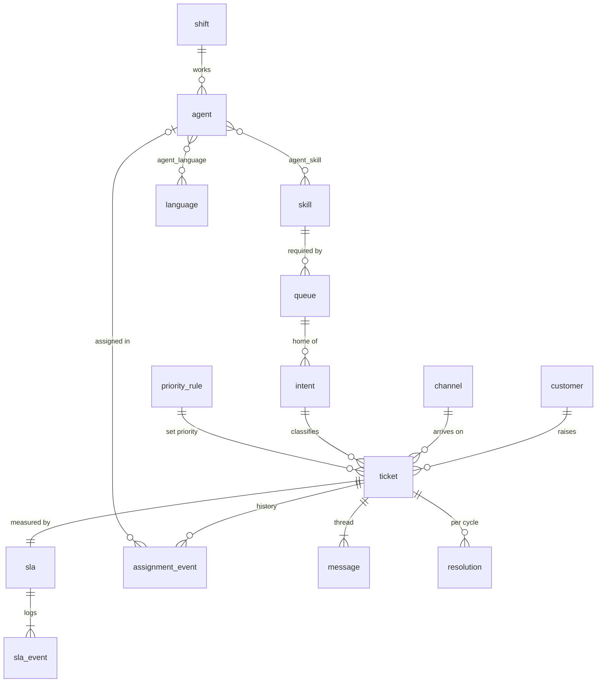

# Omnichannel Case Routing

A synthetic-data generator and routing/SLA simulator for email, chat and phone support cases.
It creates 90 days of support traffic and routes every ticket to an agent by intent, urgency,
language, skill and capacity. It tracks SLAs on per-channel business calendars, then plants five
kinds of rule violations and proves an independent checker finds exactly those.

Built for the YottaFlex AI 72-hour candidate challenge. The problem statement is in
[`prompts/002-problem-statement.md`](prompts/002-problem-statement.md).

- **Stack:** Python 3.11+, standard library only (pytest for tests), SQLite for the SQL output.
  No network services.
- **Size:** `caserouting/` is about 2,100 lines (including comments and docstrings) across 15 modules plus `schema.sql`, with 61 tests.

---

## Quickstart (fresh clone)

```bash
git clone https://github.com/saishashank-a/omnichannel-case-routing.git
cd omnichannel-case-routing
uv sync                                                   # Python 3.12 + pytest (or: pip install pytest)

uv run python -m caserouting generate --scale starter     # ~1 s  -> data/starter/
uv run python -m caserouting generate --scale full        # ~20 s -> data/full/ (30k tickets, 100k messages)
uv run python -m caserouting validate --dir data/full     # re-check a dataset from its files alone
uv run python -m caserouting repro --scale starter        # generate twice, compare SHA-256 of every file
uv run pytest                                              # 61 tests, ~2 s
```

Without `uv`, use Python 3.11+ and run `python -m caserouting ...` from the repo root. The seed
defaults to **20261022**; to change it, pass `--seed N`.

Expected `generate --scale full` output:

```
  ticket              30000
  message            100000
  agent                 100
  baseline findings 0, structural failures 0
  CAPACITY_EXCEEDED          expected  30  found  30  missed 0  false+ 0
  SLA_CALENDAR_IGNORED       expected  30  found  30  missed 0  false+ 0
  REOPEN_HISTORY_LOST        expected  30  found  30  missed 0  false+ 0
  TRANSFER_LOOP              expected  30  found  30  missed 0  false+ 0
  PRIORITY_SAFETY_VIOLATION  expected  30  found  30  missed 0  false+ 0
```

**Optional viewer.** Run `python3 -m http.server 8000`, then open `http://localhost:8000/ui/`.
It is a read-only page with SLA tables, per-ticket timelines and anomaly status (see [`ui/README.md`](ui/README.md)).

---

## The problem, in my words

A support centre receives tickets on three channels. Each ticket has to reach an agent who:
- is working right now
- has the right skill
- speaks the customer's language
- has a free slot on that channel

Each ticket also carries a promise (an SLA): a first reply and a resolution by a deadline.
Email deadlines only count business hours; critical (P1) tickets count every hour. Some tickets
go wrong in ordinary ways:
- they reach the wrong team and get **transferred**
- they run long and get **escalated**
- they come back after being solved and get **reopened**

The assignment asks for three things:
1. Generate realistic data for this, with a clean model, valid keys and a complete history.
2. Simulate the routing and SLA logic by explicit rules.
3. Show the data can be trusted: validate it, plant known faults, and prove they are caught.

## What it produces

`data/<scale>/` contains:

| Path | Contents |
|---|---|
| `csv/`, `json/` | 18 tables, one file each, rows sorted by primary key |
| `seed.sql` | DDL plus INSERTs. It loads into SQLite with foreign keys enforced (`caserouting.db` is built from it) |
| `ground_truth/` | `ground_truth.csv/json` lists the planted anomalies; `expected_decisions.csv/json` gives the rule-based priority, queue and due times per ticket before injection |
| `validation/` | `findings.json` (business-rule findings) and `structural_failures.json` |
| `metrics.json` | SLA attainment, rates, waits, CSAT, peak concurrency and detection scores |
| `validation_summary.md` | Readable summary of every check and each acceptance criterion |
| `manifest.json` | Generator command, seed, parameters, provenance, row counts and SHA-256 per file |

Starter data is committed in full. For full scale, only the manifest, metrics, validation results
and ground truth are committed. The rest (about 340 MB) regenerates identically from the seed, and
`manifest.json` holds the checksums to compare against.

## Pipeline

```mermaid
flowchart LR
    A[config.py<br/>all business rules] --> B[master.py<br/>channels, intents, queues,<br/>customers, agents + bridges]
    B --> C[arrivals.py<br/>30k tickets: seasonality, spikes,<br/>outages, priority rules,<br/>all random draws]
    C --> D[routing.py<br/>heap simulation:<br/>assign / transfer / escalate /<br/>resolve / reopen]
    D --> E[messages.py<br/>threaded messages]
    E --> F[outcomes.py + sla.py<br/>derived columns, SLA events, CSAT]
    F --> G{baseline<br/>validation<br/>must be 0}
    G --> H[anomalies.py<br/>5 labelled injections<br/>→ ground_truth/]
    H --> I[export.py<br/>CSV, JSON, seed.sql,<br/>SQLite FK check]
    I --> J[validate.py<br/>re-reads files only]
    J --> K[report.py<br/>metrics, summary,<br/>manifest + SHA-256]
```



## Data model

All 13 required entities are present, plus five supporting tables (`sla_policy`, `shift`, `sla`,
and the bridges `agent_skill` and `agent_language`). The full diagram with cardinalities,
effective dates and lifecycles is in [`docs/model.md`](docs/model.md). Every field (type, required,
allowed values, units, uniqueness, validation rule) is in
[`docs/data_dictionary.md`](docs/data_dictionary.md). The DDL is
[`caserouting/schema.sql`](caserouting/schema.sql).



IDs follow the brief exactly: `TKT-2026-000001`, `MSG-TKT-2026-000001-001`, `AGT-000001`,
`ASN-TKT-2026-000001-001` and `SLA-TKT-2026-000001`. The other entities follow the same
zero-padded pattern (`CUS-000001`, `RES-TKT-…-001`, `SLA-TKT-…-001` for SLA events, `GT-0001`).
All IDs are built in one module ([`ids.py`](caserouting/ids.py)). A test checks that primary keys
are identical across CSV, JSON and SQLite.

**History is never overwritten.** `assignment_event` and `sla_event` are append-only logs. The
ticket's `status`, `current_queue_id`, the counts, `first_response_at`, `resolved_at` and `csat`
are a snapshot computed from those logs. The validator recomputes each of them and reports any
mismatch.

## Business rules (all in [`config.py`](caserouting/config.py))

| Rule | Value |
|---|---|
| Channels and SLA calendars | Email Mon–Fri 08–18. Chat and phone Mon–Sat 07–22. Holidays Jan 1, Jan 19, Feb 16. All times UTC, no DST |
| Priority | Starts at the intent default. HIGH urgency raises it one level, ENTERPRISE raises it one level, and non-safety tickets are capped at P2. **Safety rule:** OUTAGE, SECURITY and SAFETY_HAZARD are always P1 (`PRL-005`) |
| SLA targets | First response and resolution, per priority × channel, in business minutes. P1 runs on a 24x7 clock; P2–P4 pause outside channel hours |
| Agents | 3 shifts (night wraps midnight), frontline skill pairs, Tier-2 and Sales skills, English plus an optional second language, concurrency limit per channel (email 2, chat 2, phone 1) |
| Routing | Eligible = on shift, has the queue's skill, speaks the language, below the channel limit. If no on-shift agent with the skill speaks the language, any of them may take it with `translation_flag=1`. Pick the least-loaded agent, then the lowest ID |
| Transfer | About 8% of tickets are misrouted at triage. The agent notices 20–60% into handling and transfers the ticket to the correct queue |
| Escalation | When 80% of the resolution target (business time) has elapsed and the ticket is unresolved, it moves to Tier-2, at exactly that minute |
| Reopen | Probability 5%, +10% if the resolution SLA was breached, +5% if the ticket was transferred. A new SLA cycle starts at reopen |
| CSAT (35% respond) | `5 − 1.5·breached − 0.5·transfers − 1·reopened − min(1.5, 0.25·wait_hours) + noise{−1,0,0,0,+1}`, clipped to 1–5 |
| Scenarios | Queue spikes (×4 arrivals, 09–13 on set days), outage incidents (×6 arrivals, mostly INT-OUTAGE, 14–17), after-hours arrivals (~31%), language mismatch (~3% of assignments translated) |

## Key decisions and trade-offs

1. **Standard library only.** About 130k rows don't need pandas or numpy. Every line stays
   explainable, and there is nothing heavy to install.
2. **Every random number is drawn before the simulation runs.** `arrivals.py` draws handle times,
   misroutes, reopen draws and CSAT noise per ticket from seeded streams
   (`random.Random(f"{seed}:{stage}")`). Routing then contains no randomness at all, which makes it
   a pure function of its inputs and easy to reproduce and test.
3. **A heap of routing requests, not a full discrete-event engine.** Waiting tickets retry every
   5 minutes, at the next shift start, or exactly at their escalation minute, whichever comes
   first. This takes about 150 lines and runs 30k tickets in a few seconds. **Trade-off:** priority
   only orders requests competing at the same minute, so a waiting P4 is never pre-empted by a
   newer P1.
4. **SLA outcomes are a post-pass over the recorded history.** This is what makes the
   "SLA reproducible" criterion true by construction. The validator recomputes every due time and
   outcome from tickets plus events.
5. **Escalation at an exact point (80% of the resolution target).** "SLA risk" was vague. A fixed
   point is testable: every `ESCALATE` must sit on exactly that minute.
6. **The validators are the anomaly detectors.** The checker never reads ground truth. A clean
   baseline must give 0 findings (enforced in the pipeline and in tests); after injection,
   findings must equal ground truth.
7. **Injected faults are self-consistent.** For example, a P1 ticket wrongly set to P3 gets its
   SLA rows rebuilt with P3 rules. The checker therefore has to catch the root cause, not a
   side-effect, and unrelated rows never change.
8. **Calibration.** The first version over-staffed the centre: P2–P4 met 100% of SLAs and 90% of
   tickets waited 0 minutes. Handle times and limits were tuned so queues form at peaks and
   overnight (commit `900a8cc`).

## How I know it works

| Acceptance criterion | How it is checked |
|---|---|
| Routing respects skill and capacity | Every `ASSIGN` is re-checked for shift, skill, language rule and translation-flag legitimacy. A per-agent, per-channel sweep checks concurrency. Unit tests cover each rule on hand-built scenarios |
| SLA is reproducible | Due dates and met/breached outcomes are recomputed from the ticket and its events. Two separate runs give byte-identical files |
| Escalation timing is correct | Every `ESCALATE` happens at exactly the computed 80% minute, and every unescalated cycle resolves before it. Tested directly in `test_routing.py` |
| Assignment history is complete | Per ticket `seq` is 1..n with no gaps, `REOPEN` only follows `RESOLVE`, and transitions are legal (state machine in `docs/model.md`) |

Structural checks cover:
- primary-key uniqueness and foreign-key integrity, in Python and again in SQLite with `PRAGMA foreign_keys=ON`
- enums and ID formats
- date ordering
- natural-key duplicates
- reconciliation of every derived column against the events

**Results (full scale, seed 20261022):**
- Structural failures: 0.
- Clean baseline: 0 business-rule findings.
- After injection: 150 of 150 anomalies found, 0 missed, 0 false positives.
- Reproducibility: `repro` runs the generator twice in fresh processes with different
  `PYTHONHASHSEED` values. All 45 output files match by SHA-256.

**About the 100% detection rate.** It is expected, not impressive. The detectors are exact rule
checks, and each injection is built to break exactly one rule. What it proves is that the baseline
is clean, the injections are targeted, and nothing unrelated was corrupted.

## Metrics (full scale)

| | |
|---|---|
| Tickets / messages / agents | 30,000 / 100,000 / 100 over 90 days (2026-01-01 → 2026-03-31) |
| Channel mix | Email 45%, chat 35%, phone 20% |
| Priority mix | P1 6.9%, P2 9.7%, P3 42.3%, P4 41.1% |
| After-hours arrivals | 30.7% |
| Transfer / escalation / reopen rate | 8.0% / 2.3% / 5.4% of tickets |
| Language match | 96.9% of assignments (3.1% used translation) |
| Wait to first assignment | p50 0 min, p90 281 min, p99 1,399 min |
| CSAT (n≈10.6k responses) | 5: 63%, 4: 31%, 3: 2%, 2: 3%, 1: 0.1% |

Resolution SLA attainment (first-response SLA in brackets):

| | P1 | P2 | P3 | P4 |
|---|---|---|---|---|
| Chat | 95% (28%) | 100% (69%) | 100% (95%) | 100% (99%) |
| Email | **51%** (10%) | 96% (66%) | 100% (96%) | 100% (94%) |
| Phone | 94% (59%) | 100% (85%) | 100% (97%) | 100% (99%) |

**What the numbers say.** P1 email is the weak spot. It runs on a 24x7 clock, but email work is
long and the night shift is small, so half of P1 emails breach. In a real centre this argues for
P1 pre-emption or a dedicated P1 pool; see next steps. All per-channel and per-priority metrics
are in `data/full/metrics.json`.

## Assumptions

- **Time and calendar.** UTC with no DST. The horizon is 2026-01-01 to 2026-03-31, which keeps the
  `TKT-2026` prefix consistent. Holidays close SLA calendars but not agent shifts.
- **"Master data first" means generation order**: reference → customers and agents → tickets →
  events → messages. Tickets and messages are created before their events are simulated.
- **One SLA header per ticket** (`SLA-<ticket-id>`, matching the brief) with child `sla_event`
  rows (`SLA-<ticket-id>-001…`).
- **Intent is assigned by the generator**, from documented weights. Message bodies are templates
  and play no part in routing (no NLP).
- **The safety rule** isn't defined in the brief, so I defined it: safety intents must be P1.
- **Prospects** are customers of type `PROSPECT` with no tier, sending sales intents. This covers
  the marketing/sales actor.
- **A slot is held for the agent's active work** on a ticket, from assignment until it is
  transferred, escalated or resolved.
- **Totals and balances** in Step 6 map to counts, handle minutes and concurrent load. There is no
  money in this domain.
- **No external data** is used. Language codes follow ISO 639-1.

## Limitations

- **No pre-emption.** A newly arrived P1 does not jump ahead of tickets already retrying (see
  decision 3).
- **Retry tick.** Waiting tickets re-check every 5 minutes, so waits are quantised to 5 minutes.
- **Escalation is once per ticket.** A reopened, already-escalated ticket stays in Tier-2 and is
  not escalated again.
- **CSAT is a formula with a small noise term.** It is not learned from data.
- **The full-scale CSV/JSON/SQL is not in git** because of its size. It regenerates
  deterministically, and its checksums are in `data/full/manifest.json`.
- **Routing changes over time are not exercised.** Effective dates exist on priority rules, agent
  skills and languages, but every rule is effective from day 0.

## Next steps

1. Priority pre-emption, or a reserved P1 pool, then re-measure P1 email attainment.
2. Exercise effective dating with a mid-horizon priority-rule change, so routing changes over time.
3. More anomaly types: language mismatch without a translation flag, and off-shift assignment.
4. Run the detectors on a second seed to show the 0-false-positive result is not seed-specific.

## Repository layout

```
caserouting/   config.py ids.py bizhours.py master.py arrivals.py routing.py sla.py
               messages.py outcomes.py anomalies.py validate.py report.py export.py
               pipeline.py __main__.py schema.sql
tests/         test_bizhours.py test_routing.py test_pipeline.py
docs/          model.md (ER, cardinality, lifecycle)  data_dictionary.md  PLAN.md  PLAN_CRITIC.md
data/          starter/ (full dataset)  full/ (manifest, metrics, validation, ground truth)
ui/            optional read-only viewer (built with Codex CLI)
prompts/       every prompt sent to every AI tool, in order
AI_USAGE.md    where AI helped, where I relied on it, what I verified
```

## AI usage

AI tools were used heavily and are fully disclosed. See [`AI_USAGE.md`](AI_USAGE.md) for what I
reviewed and validated, and [`prompts/`](prompts/) for every prompt.
