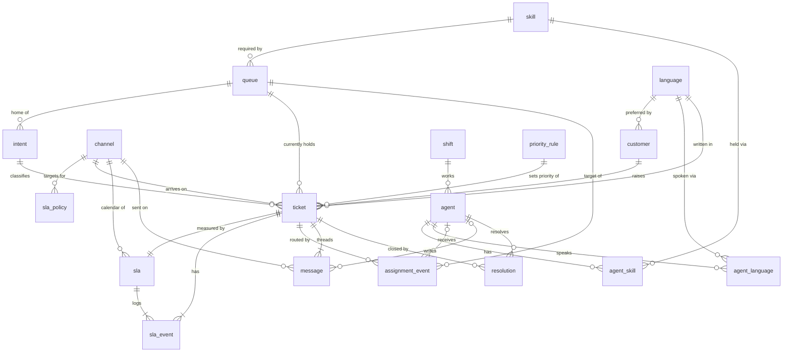
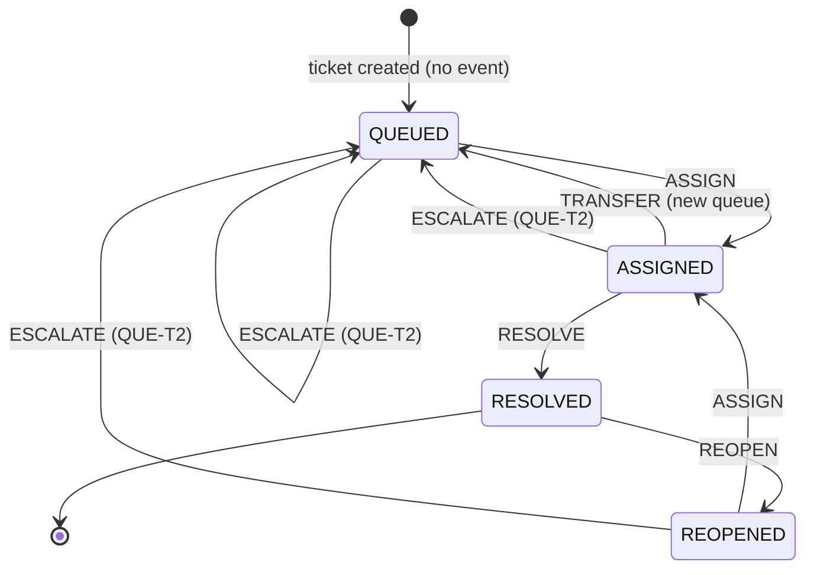

# Data model

DDL: `caserouting/schema.sql`. Field details: `docs/data_dictionary.md`.

## Entity-relationship diagram

`|o` on `agent` means the FK is nullable (`assignment_event.agent_id`, `message.agent_id`).

## Cardinality

| Relationship | Type | Optional? | Notes |
|---|---|---|---|
| skill -> queue | 1:N | Queue must have a skill | Each queue needs exactly one skill |
| queue -> intent | 1:N | Intent must have a queue | The intent's home queue |
| channel -> sla_policy | 1:N | No | 4 rows per channel (P1..P4) |
| language -> customer | 1:N | No | `preferred_language` |
| shift -> agent | 1:N | No | Each agent works one shift |
| agent <-> skill | N:M via bridge `agent_skill` | An agent has at least one skill | `effective_from` per link |
| agent <-> language | N:M via bridge `agent_language` | An agent speaks at least one language | `effective_from` per link |
| customer -> ticket | 1:N | A customer may have no tickets | |
| channel / intent / language -> ticket | 1:N | No | Required FKs |
| priority_rule -> ticket | 1:N | No | Last rule that changed the priority |
| queue -> ticket (`current_queue_id`) | 1:N | No | Derived snapshot |
| ticket -> sla | 1:1 | No | `sla.ticket_id` is UNIQUE. `sla_id = SLA-<ticket-id>` |
| sla -> sla_event | 1:N | No | At least `CLOCK_STARTED` |
| ticket -> assignment_event | 1:N | Yes: a ticket still QUEUED may have none | `UNIQUE(ticket_id, seq)` |
| agent -> assignment_event | 1:N | Yes: `agent_id` NULL for TRANSFER, ESCALATE, REOPEN | |
| queue -> assignment_event | 1:N | No | Queue after the event |
| ticket -> message | 1:N | No: at least the first customer message | `UNIQUE(ticket_id, seq)` |
| agent -> message | 1:N | Yes: `agent_id` NULL for CUSTOMER/SYSTEM messages | |
| ticket -> resolution | 1:N | Yes: unresolved tickets have none | One per cycle. `UNIQUE(ticket_id, cycle_no)` |
| agent -> resolution | 1:N | No | Resolving agent |

## Effective dates

| Table | Columns | Meaning |
|---|---|---|
| `priority_rule` | `effective_from`, `effective_to` | The rule applies to tickets created in `[effective_from, effective_to)`. NULL `effective_to` means it is still active. All current rules start at `2026-01-01T00:00:00Z` |
| `agent_skill` | `effective_from` | The agent can take tickets in queues that need this skill from this time on |
| `agent_language` | `effective_from` | The agent counts as speaking this language from this time on (used for `translation_flag`) |

Other time columns are event times, not validity ranges: `customer.created_at`, `agent.hired_at`, and every `ts`.

## Ticket lifecycle

A new ticket starts `QUEUED` in its intent's home queue, with no event. Every later state change is one `assignment_event` row. The `ticket` row's `status`, `current_queue_id` and counts come from replaying those rows in `seq` order.

| event_type | From | To | Queue / agent |
|---|---|---|---|
| `ASSIGN` | QUEUED, REOPENED | ASSIGNED | Agent set. Agent must hold the queue's skill and be under the channel limit |
| `TRANSFER` | ASSIGNED | QUEUED | New queue, agent NULL (misroute fix) |
| `ESCALATE` | ASSIGNED, QUEUED, REOPENED | QUEUED | Queue becomes `QUE-T2`, agent NULL. Fires when 80% of the resolution target is used |
| `RESOLVE` | ASSIGNED | RESOLVED | Same agent. Writes one `resolution` row |
| `REOPEN` | RESOLVED | REOPENED | Starts a new cycle (`cycle_no` + 1) |

Any other transition is invalid and fails validation.

## SLA lifecycle

Each ticket has one `sla` row. Its clock history is in `sla_event`:

1. `CLOCK_STARTED` at `ticket.created_at`, `cycle_no = 1`, with `due_at` set.
2. `FIRST_RESPONSE_MET` or `FIRST_RESPONSE_BREACHED`: first agent message at or before / after `first_response_due_at`.
3. `RESOLUTION_MET` or `RESOLUTION_BREACHED`: `RESOLVE` at or before / after the cycle's resolution due time.
4. `CLOCK_RESTARTED` on `REOPEN`. `cycle_no` goes up by 1, and the new resolution `due_at` is computed from the reopen time. The cycle then ends with its own `RESOLUTION_MET` or `RESOLUTION_BREACHED`.

Targets are business minutes. P1 uses the `24x7` calendar. P2-P4 use the `CHANNEL` calendar: EMAIL Mon-Fri 08:00-18:00, CHAT and PHONE Mon-Sat 07:00-22:00 UTC, closed on holidays (2026-01-01, 2026-01-19, 2026-02-16).

## Generation order

Parents are written before children, so every FK points to a row that already exists:

1. Reference tables: `channel`, `language`, `skill`, `queue`, `intent`, `priority_rule`, `sla_policy`, `shift`
2. `customer`, `agent`, then the bridges `agent_skill`, `agent_language`
3. `ticket` + `sla`
4. Routing: `assignment_event` + `resolution`
5. `sla_event`
6. `message`

Ticket snapshot columns are filled in from the event tables after step 6. Anomalies are injected after the clean baseline, and their labels go only to `ground_truth/`.
